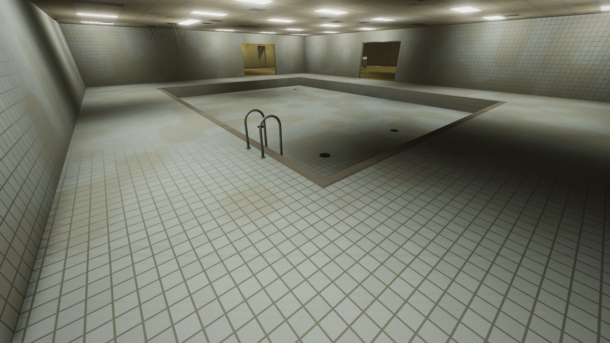
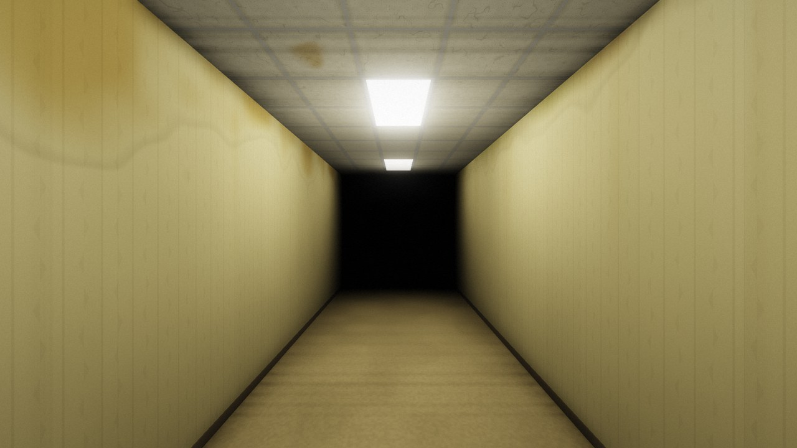
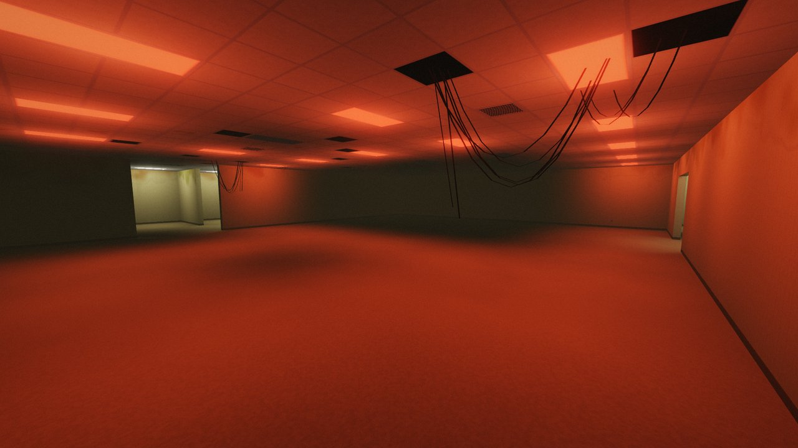
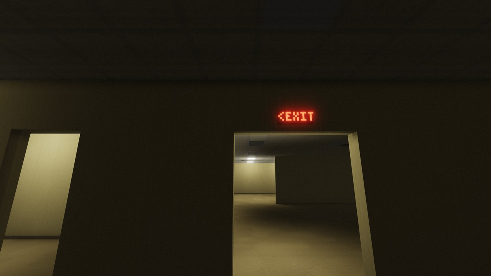
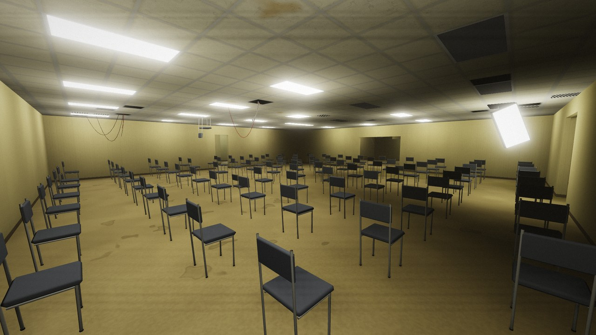
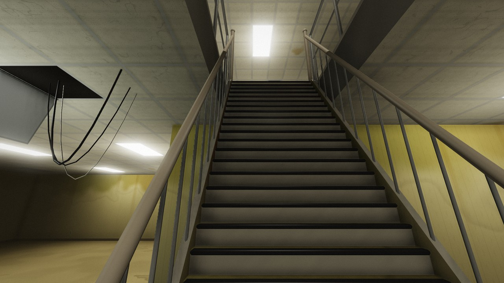
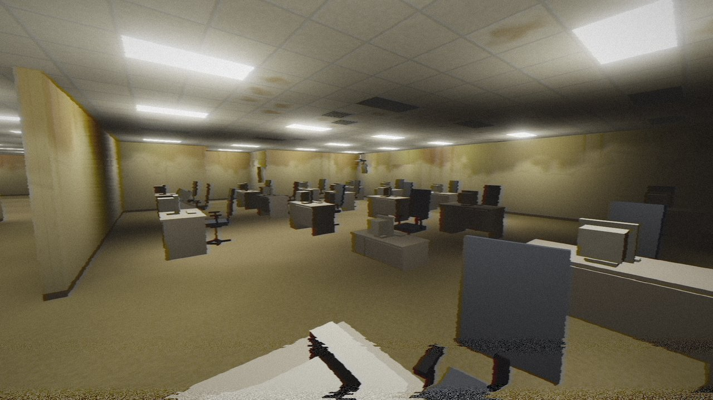

# Manila

**An endless office that was never finished. Walk it, fly it, photograph it.**

Manila is an endless, procedurally generated backrooms that runs in your browser: yellowed
wallpaper, damp carpet, and the hum of fluorescent lights that never quite stop flickering. Every
seed is a different building, and it goes on forever in every direction, including up and down.

Everything, from the walls to the sound, is generated in code from one number. There are no
textures, models or recordings. The whole game is a single HTML file of about 115 kB.

**Play it:** [pantomimic.itch.io/manila](https://pantomimic.itch.io/manila) (needs WebGPU).


## What's in it

The further you wander from where you started, the less the place holds together. Walls bow,
doors shrink into the floor, furniture turns up where it shouldn't, and the light goes wrong.

There is nothing to fight. There is a lot to find.

- **Rooms that don't fit:** a drained pool, an office left mid-shift, rows of chairs facing
  nothing, a red room, cubicle farms, closets, and a hallway that seems to go on longer than it
  should.
- **Stacked levels:** holes in the floor, odd staircases and missing ceiling tiles lead to the
  floors above and below.
- **Sound built from nothing:** the ballast hum, the odd door slamming somewhere, a phone ringing,
  and footsteps that aren't yours. All of it is synthesized with Web Audio and placed in 3D.
- **Camcorder look (V):** tape wobble, chroma smear, tracking noise and a date stamp.
- **Camera drone (F):** fly up through holes and stairwells, and out through windows.
- **Photo mode (P, or O for one every 2 seconds):** saves your photos as a .zip, or straight to a
  folder. A `where.txt` file lists a link for each photo that reopens the game at that exact spot.

| | |
|---|---|
|  |  |
|  |  |
|  |  |



## Controls

| Key | Action |
|---|---|
| WASD, mouse | Move, look |
| Shift | Run |
| C | Crouch (descend in the drone) |
| Right mouse | Zoom |
| F | Drone on/off (Space up, C down) |
| P / O | Take a photo / auto camera |
| V | Camcorder look |
| M | Mute |
| H | Stats |
| Esc | Menu: seed, photos, volume, mouse speed |

## Requirements

WebGPU. A current Chrome or Edge on desktop works best; Firefox and Safari support it on some
systems. A discrete GPU is recommended for full resolution.

## Inspiration

Manila was inspired by [abyssal-garden](https://github.com/Noniv/abyssal-garden) by Noniv, a
dreamy underwater world you swim through in the browser, generated entirely in code with WebGPU
and shipped as one small HTML file. Seeing how much atmosphere fits in a single file with no
assets at all is what started this project. Manila takes the same approach (one file, nothing
loaded, everything from code) and points it at somewhere much less pleasant.

## How it works

- **World:** the floor plan is split into chunks that are generated on demand from the seed with a
  deterministic hash, so the same seed always gives the same building. The same hash runs in the
  shaders, so surface detail matches the geometry.
- **Rooms:** cells are grouped into rooms with themes (office, pool, pits, pillars, chairs, red,
  wet, cubicles, closets, an endless hallway and more). A "mutation" value grows with distance and
  bends walls, shrinks doors, shifts colours and breaks lights.
- **Rendering:** WebGPU with WGSL shaders. Wallpaper, carpet, ceiling tiles, stains and grime are
  all procedural. Lighting is soft, wall-aware and per-panel, with bloom and a camcorder
  post-process.
- **Sound:** Web Audio oscillators and noise, shaped into a ballast hum, footsteps and distant
  events, placed with HRTF panning through a generated reverb.

### Source layout

| File | What it does |
|---|---|
| `src/main.js` | Game loop, input, menu, photo and drone modes |
| `src/gen.js` | Floor plan, rooms, walls, doors, collision |
| `src/levels.js` | Stacked levels, stairs, furniture, wall details, chunk meshes |
| `src/shaders.js` | WGSL: procedural surfaces and lighting |
| `src/render.js`, `src/post.js` | WebGPU setup, bloom, camcorder effect |
| `src/audio.js` | Synthesized sound |
| `src/drone.js` | Drone flight and collision |
| `src/photos.js` | Photo capture and the .zip writer |

## Building

```sh
npm install
npm run build            # writes index.html (minified)
npm run build:readable   # unminified, for debugging
```

Open `index.html` in a WebGPU browser. Add `?seed=1234` to the URL to pick a building.

---

Made by Pantomimic Software. Released under the [MIT License](LICENSE).
